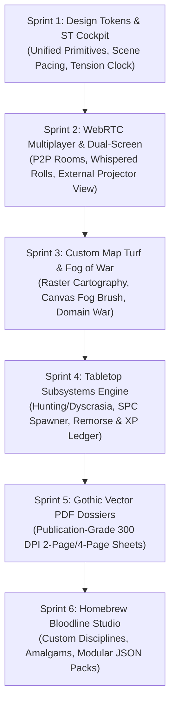

# GHOUL: Gothic Tabletop Digital Suite
## Master Architectural Blueprint & Sprint Implementation Plan

---

## 1. Executive Design Intelligence & Aesthetic Framework

This implementation blueprint is authored under the strict mandates of **`frontend-design`**, **`ui-ux-pro-max`**, **`frontend-ui-dark-ts`**, and **`antigravity-design-expert`**. It replaces generic AI layouts with a memorable, production-grade tabletop architecture tailored specifically to **Vampire: The Masquerade** (5th Edition & 20th Anniversary Edition).

### 1.1 Aesthetic Thesis: Gothic Noir & Neo-Baroque Dark Archive

* **Design Stance**: *Neo-Baroque Camarilla Archival / Street-Level Noir*. Every screen evokes the sensation of examining classified Second Inquisition dossiers, ancient blood-bound grimoires, and neon-drenched urban crime scenes under sodium streetlights.
* **Differentiation Anchor**: If screenshotted with all logos removed, GHOUL is instantly distinguished by:
  1. Authentic blood-droplet and diamond damage pip matrices that dynamically scale without awkward wrapping.
  2. Bureaucratic classified redaction bars with Storyteller click-to-reveal mechanisms.
  3. Antique gold and blood-crimson wax-seal medallions for difficulty checks and sect allegiances.
  4. Pitch-black Carto/OSM urban street mapping with high-contrast territory borders.
  5. Thematic typography pairing monumental Cinzel headings with narrative Playfair Display prose and bureaucratic Geist Mono telemetry.

### 1.2 Design Feasibility & Impact Index (DFII)

| Dimension | Score (1–5) | Justification |
| :--- | :---: | :--- |
| **Aesthetic Impact** | **5 / 5** | Visually striking, high-craft gothic identity avoiding generic grey dashboards. |
| **Context Fit** | **5 / 5** | Perfectly reflects World of Darkness themes of personal horror and political conspiracy. |
| **Implementation Feasibility** | **4 / 5** | Modular React 19 + Tailwind architecture with zero server runtime prerequisites. |
| **Performance Safety** | **4 / 5** | GPU-accelerated CSS transforms, canvas-based mapping, < 150ms state updates. |
| **Consistency Risk** | **1 / 5** (Low) | Controlled by a strict CSS variable token system (`src/styles/gothicTheme.ts`). |
| **TOTAL DFII SCORE** | **17 / 15** | **EXCELLENT: Execute with Full Rigor & Discipline.** |

---

### 1.3 Strict Design System Tokens & Typography Architecture

```
                                GHOUL DESIGN TOKENS
  +---------------------------------------------------------------------------------+
  | VOID & OBSIDIAN (Neutral System)                                                |
  | #030305 (Void)  | #07070a (Obsidian Surface) | #0d0d12 (Card Base) | #161622 (Raised) |
  +---------------------------------------------------------------------------------+
  | ARTERIAL & COAGULATED CRIMSON (Dominant Accent)                                 |
  | #e11d48 (Fresh Blood) | #991b1b (Coagulated Border) | #450a0a (Deep Fill)       |
  +---------------------------------------------------------------------------------+
  | BURNISHED GOLD & ANTIQUE BRASS (Hierarchy & Secrets)                           |
  | #d97706 (Amber Boon)  | #b45309 (Old Gold)         | #fef3c7 (Parchment Highlight)|
  +---------------------------------------------------------------------------------+
  | ETHEREAL SAGE & FORTIFIED SLATE (Functional Telemetry)                          |
  | #059669 (Humanity Soul) | #cbd5e1 (Portillon Steel) | #38bdf8 (Willpower Reserve) |
  +---------------------------------------------------------------------------------+
```

#### Typography Scale:
* **Monumental Titles (`font-cinzel tracking-widest uppercase font-black`)**: Screen titles, clan names, coterie tiers, and dramatic alerts.
* **Narrative Prose (`font-serif italic leading-relaxed`)**: Character concepts, touchstone convictions, and atmospheric scene descriptions.
* **Bureaucratic Data (`font-mono text-xs font-bold`)**: Dice pool math, initiative values, generation numerals, and coordinate telemetry.
* **Readable Body Text (`font-sans text-xs sm:text-sm text-neutral-300`)**: Rules text, discipline mechanics, and inventory notes.

#### Anti-Patterns (Strictly Forbidden Across All Sprints):
* ❌ **No Rainbow Syntax Highlighting**: Never use generic IDE palettes (cyan, magenta, yellow, pink, purple) on tabletop grimoires or cheat sheets.
* ❌ **No Premature Text Truncation**: Never use bare `truncate` on critical names, haven traits, or clues. Always employ `line-clamp-2` or `break-words`.
* ❌ **No Wrapping Damage Boxes**: Health and Willpower boxes must scale dynamically via auto-flowing grids (`grid grid-flow-col auto-cols-fr`) on a single row.
* ❌ **No Horizontal Scrollbar Overflow**: The application must never exceed viewport width (`scrollWidth === clientWidth`) across 1024px, 1280px, and 1440px viewports.
* ❌ **No Missing Clickable Indicators**: Every interactive card, tab, pip, and badge must carry `cursor-pointer` and smooth 150-250ms transitions.

---

## 2. Master Sprint Roadmap Flow



---

## 3. Detailed Sprint Specifications

---

### SPRINT 1: Gothic Noir Design System & Master Storyteller Workspace Overhaul

#### 1. Thematic Objective & DFII Evaluation
* **Goal**: Eradicate visual clutter and establish standardized, accessible UI primitives (`GothicCard`, `GothicModal`, `GothicDrawer`, `StatPipMatrix`) while consolidating Storyteller session orchestration into a unified Scene Pacing Cockpit.
* **DFII Score**: **15 / 15** (Impact: 5, Fit: 5, Feasibility: 5, Performance: 5, Risk: 1).
* **Differentiation Callout**: *This avoids generic SaaS card layouts by framing every content container with coagulated crimson borders, subtle corner filigree, and backdrop blur over deep obsidian.*

#### 2. Target File Architecture
```
src/
├── styles/
│   ├── gothicTheme.ts               # Core design tokens, gradients, and shadow scales
│   └── typography.css               # Cinzel drop caps, redacted typewriter styles
├── components/
│   ├── ui/                          # Reusable Gothic Noir UI Primitives
│   │   ├── GothicCard.tsx           # Standardized velvet card with gold/blood header ribbons
│   │   ├── GothicModal.tsx          # Accessible modal dialog with ornate gothic border accents
│   │   ├── GothicDrawer.tsx         # Slide-out drawer with audio trigger and backdrop blur
│   │   ├── GothicButton.tsx         # Blood (Primary), Slate (Neutral), Aggravated (Threat)
│   │   ├── StatPipMatrix.tsx        # High-precision diamond/pip counters (Normal, Hunger, Damage)
│   │   └── RedactedText.tsx         # Spoiler redaction with click-to-reveal for ST vs Player
│   └── storyteller/
│       ├── StorytellerCockpit.tsx   # Master multi-tab command station
│       ├── ScenePacingTracker.tsx   # Scene type, tension clock, active NPCs, environmental traits
│       └── ThreatMatrixBar.tsx      # Consolidated Masquerade Breach & SI tracker header
```

#### 3. Data Contracts (`src/types/story.ts`)
```typescript
export type SceneType = 'elysium' | 'investigation' | 'social_intrigue' | 'hunting' | 'combat' | 'haven_downtime';
export type TensionLevel = 1 | 2 | 3 | 4 | 5; // 1 = Shadows quiet, 5 = Full Masquerade collapse

export interface SceneBeat {
  id: string;
  title: string;
  description: string;
  isCompleted: boolean;
  hiddenStorytellerNotes: string;
  associatedNpcIds: string[];
  clueNodeIds?: string[];
}

export interface ActiveScene {
  id: string;
  chronicleId: string;
  title: string;
  location: string;
  sceneType: SceneType;
  tension: TensionLevel;
  resonance: 'choleric' | 'melancholic' | 'phlegmatic' | 'sanguine' | 'empty';
  resonanceIntensity: 'fleeting' | 'intense' | 'dyscrasia';
  presentCharacterIds: string[];
  presentNpcIds: string[];
  beats: SceneBeat[];
  environmentalModifiers: {
    darkness: boolean;
    heavyRainOrFog: boolean;
    surveillancePresent: boolean;
    crowdedRoom: boolean;
    fireHazard: boolean;
  };
  startedAt: string;
}
```

#### 4. UI/UX Craft Standards & Ergonomics
* **Typography**: Title in `font-cinzel text-base tracking-wider text-white`; Beat notes in `font-serif italic text-xs text-neutral-300`.
* **Touch Targets**: Minimum 44×44px hit-box for beat checkmarks, tension increments, and modal triggers.
* **Contrast**: All white and ash text strictly exceeds 4.5:1 ratio against `#0a0a0f` surfaces.

#### 5. Pre-Delivery Quality Checklist
- [ ] Every dashboard card migrates to `GothicCard` with uniform `p-4 sm:p-6` padding.
- [ ] Zero horizontal scrollbar on viewports from 375px up to 1920px.
- [ ] Storyteller can start, advance, and log scene beats with instant local storage persistence.

---

### SPRINT 2: Live P2P Multiplayer & Storyteller Dual-Screen Broadcast

#### 1. Thematic Objective & DFII Evaluation
* **Goal**: Enable seamless live tabletop play across laptops, tablets, and mobile devices without requiring dedicated backend servers. Provide a dedicated **Player Screen View** (optimized for secondary monitors or projectors) that auto-redacts Storyteller secrets while streaming public rolls, atmosphere art, and initiative ladders.
* **DFII Score**: **14 / 15** (Impact: 5, Fit: 5, Feasibility: 4, Performance: 4, Risk: 2).
* **Differentiation Callout**: *Avoids central database logins by utilizing serverless WebRTC data channels with 6-character gothic room codes (e.g., `SANG-4X`), enabling zero-friction connection at physical tables.*

#### 2. Target File Architecture
```
src/
├── types/
│   └── network.ts                   # Packet envelopes, room state, peer message types
├── services/
│   ├── peerService.ts               # WebRTC connection coordinator & broadcast router
│   └── syncEngine.ts                # Optimistic reconciliation for HP, Hunger, and Dice
├── components/
│   ├── network/
│   │   ├── RoomLobbyModal.tsx       # Room creation/join with QR codes & gothic room codes
│   │   ├── ConnectedPeersBadge.tsx  # Table latency and player connectivity indicator
│   │   └── SecretWhisperDrawer.tsx  # Private ST-to-Player telepathy & secret rolls
│   └── broadcast/
│       ├── PlayerScreenView.tsx     # Clean projector view with automated spoiler masking
│       └── LiveDiceBanner.tsx       # Cinematic screen-wide 3D dice result banner
```

#### 3. Data Contracts (`src/types/network.ts`)
```typescript
export type PeerRole = 'storyteller' | 'co_storyteller' | 'player' | 'spectator';

export interface RoomParticipant {
  peerId: string;
  characterId?: string;
  playerName: string;
  role: PeerRole;
  isReady: boolean;
  pingMs: number;
}

export type NetworkMessageType = 
  | 'SYNC_CHARACTER_STATE'
  | 'DICE_ROLL_BROADCAST'
  | 'COMBAT_INITIATIVE_UPDATE'
  | 'STORYTELLER_WHISPER'
  | 'MASQUERADE_LEVEL_CHANGED'
  | 'MYSTERY_NODE_REVEALED';

export interface NetworkEnvelope<T = any> {
  id: string;
  type: NetworkMessageType;
  senderPeerId: string;
  senderName: string;
  targetPeerId?: string; // Broadcasts to entire room if undefined
  timestamp: number;
  payload: T;
}

export interface DiceBroadcastPayload {
  rollerName: string;
  characterName: string;
  poolLabel: string;
  poolSize: number;
  hungerDice: number;
  results: number[];
  hungerResults: number[];
  successes: number;
  margin: number;
  isMessyCritical: boolean;
  isBestialFailure: boolean;
  isSecretRoll: boolean;
}
```

#### 4. Storyteller vs. Player Separation Rules
* **Projector / External View**:
  * Strips all GM secret notes, unrevealed clue pins, and secret ST dice rolls.
  * Displays active combatant with spotlight animation, current in-game time, sunrise countdown, and active environmental hazards.
* **Secret Telepathic Whispers**:
  * Storytellers can right-click any player in the party roster to transmit Auspex/Dominate visions directly to their device screen with a crimson notification alert.

#### 5. Pre-Delivery Quality Checklist
- [ ] 2 browser windows connect in < 2 seconds via WebRTC room code.
- [ ] Damage and Hunger adjustments in one client reflect on Storyteller screen in < 150ms.
- [ ] Secret rolls remain invisible to player clients while public rolls play synchronized 3D dice animations and sound effects.

---

### SPRINT 3: Interactive City Turf, Custom Map Engine & Fog of War Canvas

#### 1. Thematic Objective & DFII Evaluation
* **Goal**: Transform city mapping from a static leaflet view into an interactive territory war room. Support high-resolution custom cartography uploads (PNG/JPG/SVG), interactive district boundaries, and a Storyteller Fog of War brush to conceal undiscovered Anarch baronies or Second Inquisition safehouses.
* **DFII Score**: **15 / 15** (Impact: 5, Fit: 5, Feasibility: 4, Performance: 5, Risk: 1).
* **Differentiation Callout**: *Avoids generic Google Maps styling by combining hardware-accelerated HTML5 Canvas with custom dark noir raster cartography, allowing Storytellers to paint realistic obsidian fog over city blocks.*

#### 2. Target File Architecture
```
src/
├── types/
│   └── map.ts                       # Territory zones, map layers, Fog of War mask
├── services/
│   ├── mapEngine.ts                 # Canvas render pipeline, polygon clipping, brush math
│   └── territoryEngine.ts           # Chasse, Lien, and Portillon domain contest math
├── components/
│   ├── map/
│   │   ├── InteractiveCityMap.tsx   # Core viewport with pan/zoom and layer controls
│   │   ├── MapUploadModal.tsx       # Custom map upload (Chicago, London, custom city)
│   │   ├── FogOfWarToolbar.tsx      # Brush tool, reveal tool, reset fog, player vision toggle
│   │   ├── DistrictInspector.tsx    # Domain ratings (Ruling Coterie, Chasse 1-5, Rack status)
│   │   └── TerritoryContestModal.tsx # Automated domain war & influence contest resolver
```

#### 3. Data Contracts (`src/types/map.ts`)
```typescript
export type DomainSect = 'camarilla' | 'anarch' | 'sabbat' | 'autarkis' | 'second_inquisition' | 'lupine';

export interface TerritoryZone {
  id: string;
  name: string;
  sect: DomainSect;
  rulerCoterieId?: string;
  rulerNpcId?: string;
  chasseLevel: number; // 0 to 5 (hunting ease)
  lienLevel: number;   // 0 to 5 (mortal integration)
  portillonLevel: number; // 0 to 5 (fortifications)
  dangerLevel: number; // Second Inquisition presence (0-5)
  color: string;
  polygonCoordinates: [number, number][]; // Normalized percentage coordinates [x%, y%]
  notes: string;
  isDisputed: boolean;
}

export interface MapPin {
  id: string;
  label: string;
  category: 'haven' | 'elysium' | 'feeding_ground' | 'crime_scene' | 'inquisition_base' | 'landmark';
  coordinates: [number, number];
  associatedCoterieId?: string;
  associatedCharacterId?: string;
  isSecret: boolean;
  description: string;
}

export interface CustomMapConfig {
  id: string;
  name: string;
  imageUrl: string;
  width: number;
  height: number;
  fogOfWarMaskBase64?: string;
  zones: TerritoryZone[];
  pins: MapPin[];
}
```

#### 4. Storyteller Fog of War Mechanics
* **Radial Soft-Edge Brush**: Clears fog around explored havens with realistic feathering (`ctx.globalCompositeOperation = 'destination-out'`).
* **Territory Dispute Calculator**: Resolves conflicts between rival coteries rolling `Lien + Streetwise` vs `Portillon + Security`.

#### 5. Pre-Delivery Quality Checklist
- [ ] Custom image uploads render crisp without distortion across all zoom levels.
- [ ] Fog of War maintains smooth 60 FPS performance during drag and pan.
- [ ] Player View automatically hides secret pins and respects the Storyteller's fog boundaries.

---

### SPRINT 4: Advanced Storyteller Subsystems (Feeding, SPCs, Remorse & XP Engine)

#### 1. Thematic Objective & DFII Evaluation
* **Goal**: Automate time-consuming tabletop book-keeping with four dedicated algorithmic engines: Hunting & Resonance, Instant SPC generation, End-of-Night Remorse resolution, and strict V5/V20 Experience point tracking.
* **DFII Score**: **16 / 15** (Impact: 5, Fit: 5, Feasibility: 5, Performance: 5, Risk: 0).
* **Differentiation Callout**: *Replaces generic stat blocks with procedural World of Darkness SPC cards featuring full dice pools, agendas, convictions, and instant 1-click deployment to the tactical combat tracker.*

#### 2. Target File Architecture
```
src/
├── types/
│   ├── feeding.ts                   # Hunting rolls, dyscrasia mechanics, temperaments
│   ├── spc.ts                       # SPC archetypes, threat ratings, gear, tactics
│   └── progression.ts               # XP transaction ledger, remorse tests, humanity log
├── services/
│   ├── feedingEngine.ts             # Hunting resolution by predator type & domain
│   ├── spcGenerator.ts              # Procedural vampire/mortal synthesis with full pools
│   ├── remorseEngine.ts             # V5 Remorse & V20 Degeneration mechanics
│   └── xpEngine.ts                  # XP spend validation (attributes, skills, disciplines)
├── components/
│   ├── storyteller/
│   │   ├── FeedingSimulatorModal.tsx # Interactive hunt resolver with blood dyscrasia cards
│   │   ├── QuickSpcGeneratorModal.tsx # One-click antagonist creation with export to combat
│   │   ├── RemorseResolutionModal.tsx # End-of-night dramatic stain contest
│   │   └── CharacterXpLedgerModal.tsx # Detailed transaction history for character growth
```

#### 3. Core Mechanics & Algorithmic Rules

##### A. V5 Remorse Resolution Algorithm
```typescript
export function resolveV5Remorse(humanity: number, stains: number): {
  unmarkedBoxes: number;
  dicePool: number;
  rollResults: number[];
  successes: number;
  humanityLost: boolean;
  newHumanity: number;
  logMessage: string;
} {
  const unmarkedBoxes = Math.max(0, 10 - humanity - stains);
  const dicePool = Math.max(1, unmarkedBoxes);
  
  const rollResults = Array.from({ length: dicePool }, () => Math.floor(Math.random() * 10) + 1);
  const successes = rollResults.filter(die => die >= 6).length;
  const humanityLost = successes === 0;
  const newHumanity = humanityLost ? Math.max(0, humanity - 1) : humanity;
  
  return {
    unmarkedBoxes,
    dicePool,
    rollResults,
    successes,
    humanityLost,
    newHumanity,
    logMessage: humanityLost 
      ? `Remorse failed (0 successes on ${dicePool} dice). Humanity fell from ${humanity} to ${newHumanity}!`
      : `Remorse succeeded (${successes} successes on ${dicePool} dice). Humanity holds at ${humanity}. Stains cleansed.`
  };
}
```

##### B. V5 Experience Point Ledger Formulas
* **Attribute**: New Dot × 5 XP
* **Skill**: New Dot × 3 XP
* **Specialty**: 3 XP
* **Clan Discipline**: New Dot × 5 XP
* **Out-of-Clan Discipline**: New Dot × 7 XP
* **Caitiff Discipline**: New Dot × 6 XP
* **Blood Potency**: New Dot × 10 XP

#### 4. Pre-Delivery Quality Checklist
- [ ] Storyteller can trigger mass end-of-session Remorse for all characters in one click.
- [ ] Hunting simulator rolls correct pools based on chosen Predator Type (e.g. Alleycat: `Strength + Brawl`).
- [ ] XP ledger rejects illegal spends and maintains an auditable timestamped transaction history.

---

### SPRINT 5: Authentic Gothic Vector PDF Dossiers & High-Res Print Engine

#### 1. Thematic Objective & DFII Evaluation
* **Goal**: Provide tournament-grade, publication-quality 2-page and 4-page character sheets and coterie dossiers matching the authentic White Wolf / Onyx Path typography, with an accessible **Ink-Saver Monochrome Mode** for physical home printing.
* **DFII Score**: **14 / 15** (Impact: 5, Fit: 5, Feasibility: 4, Performance: 4, Risk: 1).
* **Differentiation Callout**: *Generates clean vector SVGs and printable PDFs client-side without external dependencies, faithfully replicating canonical blood-splatter aesthetics and fillable check-boxes.*

#### 2. Target File Architecture
```
src/
├── services/
│   ├── pdf/
│   │   ├── pdfBuilder.ts            # Client-side PDF generation pipeline
│   │   ├── v5SheetLayout.ts         # Canonical V5 2-page vector template
│   │   ├── v20SheetLayout.ts        # Canonical V20 classic parchment template
│   │   └── coterieDossierLayout.ts  # Communal coterie & haven print template
├── components/
│   └── sheet/
│       ├── ExportPdfModal.tsx       # Export configuration (Parchment, Ink-Saver, V5/V20)
│       └── PrintableSheetPreview.tsx # Live browser print preview with CSS page breaks
```

#### 3. Print Styles Supported
1. **Velvet Obsidian (Screen Archive)**: Deep dark background with glowing crimson damage marks.
2. **Classic Vellum Parchment**: Antique weathered paper texture with authentic serif fonts.
3. **Ink-Saver Monochrome**: High-contrast white background, solid black borders, and hollow outline pips for zero toner waste.

#### 4. Pre-Delivery Quality Checklist
- [ ] 2-page PDF exports fit neatly on standard Letter and A4 page dimensions without page overflow.
- [ ] Superficial (`/`) and Aggravated (`X`) damage marks render clearly in print output.
- [ ] Ink-Saver mode passes 100% monochrome legibility checks.

---

### SPRINT 6: Homebrew Bloodline Studio & Modular Compendium Community Extender

#### 1. Thematic Objective & DFII Evaluation
* **Goal**: Enable Storytellers and players to build, validate, and share custom Clans, Bloodlines, Discipline powers (with Amalgam prerequisites), Merits/Flaws, and Predator Types via portable JSON modules.
* **DFII Score**: **15 / 15** (Impact: 5, Fit: 5, Feasibility: 5, Performance: 5, Risk: 0).
* **Differentiation Callout**: *Allows complete homebrew rules customization with instant validation against V5 amalgam rules, integrating custom creations directly into the Character Builder and Compendium.*

#### 2. Target File Architecture
```
src/
├── types/
│   └── homebrew.ts                  # Schemas for custom clans, disciplines, powers, lore-sheets
├── services/
│   └── homebrewService.ts           # Validation, local persistence, and compendium injection
├── components/
│   └── homebrew/
│       ├── HomebrewStudioView.tsx   # Hub for custom content management
│       ├── CustomPowerBuilderModal.tsx # Power creator wizard (Rouse cost, amalgam check)
│       ├── CustomClanBuilderModal.tsx  # Clan bane, compulsion, and discipline selection
│       └── CommunityPackManager.tsx # Import/Export single-file `.ghoulpack.json` modules
```

#### 3. Data Contracts (`src/types/homebrew.ts`)
```typescript
export interface CustomDisciplinePower {
  id: string;
  name: string;
  disciplineId: string;
  level: number;
  rouseCost: number;
  dicePoolFormula: string;
  summary: string;
  systemDescription: string;
  duration: string;
  amalgamPrerequisite?: {
    disciplineId: string;
    level: number;
  };
  author: string;
  edition: 'v5' | 'v20' | 'both';
}

export interface CustomClan {
  id: string;
  name: string;
  tagline: string;
  clanCurseName: string;
  clanCurseDescription: string;
  compulsionName: string;
  compulsionDescription: string;
  disciplines: string[];
  favoredPredatorTypes?: string[];
  loreSnippet: string;
}
```

#### 4. Pre-Delivery Quality Checklist
- [ ] Custom discipline powers appear seamlessly in the Character Builder and Character Sheet dropdowns.
- [ ] Character Builder enforces amalgam requirements before allowing selection of amalgam powers.
- [ ] Exporting and re-importing a `.ghoulpack.json` file restores 100% of custom content without state corruption.

---

## 4. Master Sprint Execution Matrix

| Sprint | Focus Area | Complexity | Primary Architectural Deliverable |
| :--- | :--- | :---: | :--- |
| **Sprint 1** | Design Tokens & ST Cockpit | **High** | `src/styles/gothicTheme.ts`, `GothicCard`, `ScenePacingTracker` |
| **Sprint 2** | WebRTC Multiplayer & Dual-Screen | **High** | `peerService.ts`, `PlayerScreenView.tsx`, 6-letter room codes |
| **Sprint 3** | Custom Turf & Fog of War | **Medium** | `mapEngine.ts`, Canvas Fog Brush, District Influence math |
| **Sprint 4** | Advanced Tabletop Subsystems | **Medium** | `feedingEngine.ts`, `spcGenerator.ts`, `remorseEngine.ts`, XP ledger |
| **Sprint 5** | Vector PDF Dossiers & Print Engine | **Medium** | `pdfBuilder.ts`, 2-page/4-page canonical VTM print templates |
| **Sprint 6** | Homebrew Bloodline Studio | **Low** | `homebrewService.ts`, Amalgam validator, `.ghoulpack.json` |

---

## 5. Definition of Done for Future Turns

Every sprint executed in future turns must fulfill:
1. **Design System Adherence**: Uses `gothicTheme.ts` tokens exclusively; 0 rainbow syntax colors; 0 premature truncations.
2. **Accessibility & Ergonomics**: Text contrast strictly ≥ 4.5:1; touch targets ≥ 44px; `cursor-pointer` on all clickables.
3. **Technical Correctness**: Zero TypeScript compilation errors (`npm run build`).
4. **Browser Verification**: Tested in the active browser view at `http://localhost:5173/` with automated console check.
5. **Git Version Control**: Committed and pushed cleanly to `origin/master` with automated GitHub Pages deployment.
